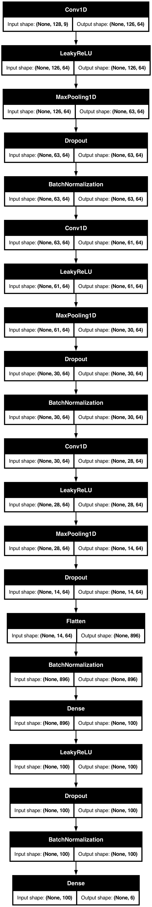
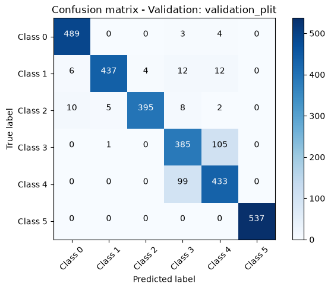
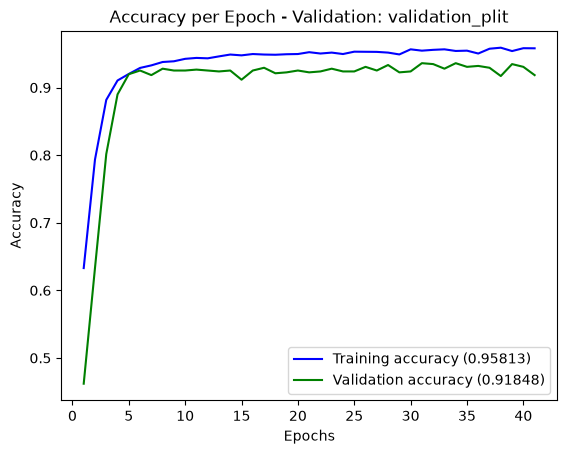
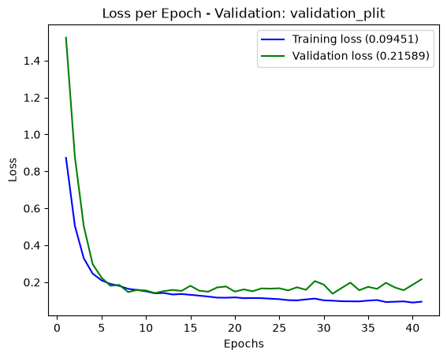

# Human Activity Recognition using Convolutional Neural Networks with Tensorflow 2 and Keras

More information about the project setup will be available soon..

## Resources

The project uses the famous *Human Activity Recognition Dataset*. Please, read the information link provided below to have a good indication of the dataset format.

* information: [Human Activity Recognition Using Smartphones DataSet](https://archive.ics.uci.edu/dataset/240/human+activity+recognition+using+smartphones)
* download: handled by `helper_functions/download_dataset.py` (see [Dataset](#dataset))

## Setup

### Environment

Requires Python 3.10 - 3.12 and TensorFlow 2.18+ (Keras 3).

```bash
python3.12 -m venv .venv
source .venv/bin/activate
pip install -r requirements.txt          # or: pip install -r requirements.lock (exact tested versions)
```

> **Note:** since TensorFlow 2.21, TensorBoard is no longer installed together with TensorFlow (versions 2.18 - 2.20 still installed it). This project does not need it; if you want to use it, install it separately with `pip install tensorboard`.

Optional:
* `pip install tensorflow-metal` for GPU acceleration on Apple Silicon.
* `pip install tensorboard` to visualize training logs.
* `brew install graphviz` (or `apt install graphviz`) to export the model design diagram; without it the export is skipped.

### Run

```bash
python nn_mains/har_main.py                       # train, evaluate and save the model (.keras)
python nn_mains/har_main.py -m load -t true       # load the saved model and evaluate on the test set
```

All settings come from `nn_configuration_files/har_config.json`. The command line options `-e/--epoch`, `-m/--mode` (`save`/`load`) and `-t/--testevaluation` (`true`/`false`) override `num_epochs`, `mode` and `evaluate_test` only when given; `-c/--config` selects another configuration file.

Models are saved in the native Keras format (`nn_experiments/<exp_name>/saved_models/<exp_name>_model.keras`).
Models saved as `.h5` with older TensorFlow versions must be retrained.

### Dataset

The dataset is **downloaded automatically** on the first training run (`auto_download: true` in `configs/nn_setup.yml`). To download it manually:

```bash
python helper_functions/download_dataset.py
```

The script downloads the archive from this repository's [`dataset-v1.0` release](https://github.com/tzamalisp/Human-Activity-Recognition-with-Tensorflow2-and-Keras/releases/tag/dataset-v1.0), falls back to the official UCI repository, verifies the SHA-256 checksum and extracts it to `datasets/UCI HAR Dataset/`. Options: `--force` to download again, `--zip <file>` to use a local copy, `--folder <name>` for a different folder name (it must match `data_folder` in `configs/nn_setup.yml`).

#### Dataset license and citation

The dataset is not covered by this repository's license. Its authors require that use in publications is acknowledged by citing:

> Davide Anguita, Alessandro Ghio, Luca Oneto, Xavier Parra and Jorge L. Reyes-Ortiz. *A Public Domain Dataset for Human Activity Recognition Using Smartphones.* 21st European Symposium on Artificial Neural Networks, Computational Intelligence and Machine Learning, ESANN 2013. Bruges, Belgium, 24-26 April 2013.

The dataset is distributed AS-IS and commercial use is prohibited.

## Results

Results of the `har` experiment (`nn_configuration_files/har_config.json`), trained with TensorFlow 2.21 / Keras 3.15 on the raw inertial signals (9 channels × 128 timesteps per window). All outputs are in [`nn_experiments/har/`](nn_experiments/har).

| Metric | Value |
|---|---|
| **Test accuracy** | **92.33%** (2,947 windows) |
| Test loss | 0.238 |
| Best validation accuracy | 93.61% (epoch 31) |
| Training stopped at | epoch 41 of 50 (early stopping, patience 10) |
| Parameters | 121,298 (119,050 trainable) |

### Model

Three `Conv1D` blocks (64 filters, kernel 3) followed by `LeakyReLU` (slope 0.1), `MaxPooling1D`, `Dropout` (0.5) and `BatchNormalization`, then `Flatten` → `Dense(100)` + `LeakyReLU` → `Dense(6, softmax)`. The convolutional and hidden dense layers use a `linear` activation, so the non-linearity comes from the `LeakyReLU` layers.

Training: Adam, categorical cross-entropy, batch size 32, 10% of the training set held out for validation. `ModelCheckpoint` and `EarlyStopping` both monitor `val_accuracy`, so the evaluated model is the saved one. The random seed is fixed, so the run is reproducible.



### Per-class results (test set)

| Activity | Precision | Recall | F1-score | Support |
|---|---|---|---|---|
| WALKING | 0.99 | 0.99 | 0.99 | 496 |
| WALKING_UPSTAIRS | 0.98 | 0.95 | 0.97 | 471 |
| WALKING_DOWNSTAIRS | 0.98 | 0.98 | 0.98 | 420 |
| SITTING | 0.80 | 0.79 | 0.79 | 491 |
| STANDING | 0.81 | 0.84 | 0.83 | 532 |
| LAYING | 1.00 | 1.00 | 1.00 | 537 |
| **Macro average** | **0.93** | **0.92** | **0.93** | 2,947 |

The dynamic activities and LAYING are recognised almost perfectly. Most errors are between **SITTING and STANDING** (103 SITTING windows predicted as STANDING and 85 the other way round), two static postures that look very similar in the accelerometer and gyroscope signals.

| Confusion matrix | Accuracy | Loss |
|---|---|---|
|  |  |  |

The full classification report and the per-window softmax probabilities are in [`class_reports/`](nn_experiments/har/class_reports) and [`dataframes/`](nn_experiments/har/dataframes).

## Related Work

The Object-Oriented Programming design is deployed for the implementation of this project. It is also based on the following related works, but it extends them in the Neural Network Design and the functionalities that previous authors implemented:

* https://machinelearningmastery.com/cnn-models-for-human-activity-recognition-time-series-classification/
* https://github.com/SantoshPattar/ConvNet-OOP
* https://github.com/MrGemy95/Tensorflow-Project-Template

## Future Work

* More comments will be added to the code.
* The logs creation functionality will be added soon.

More information will be available soon..
